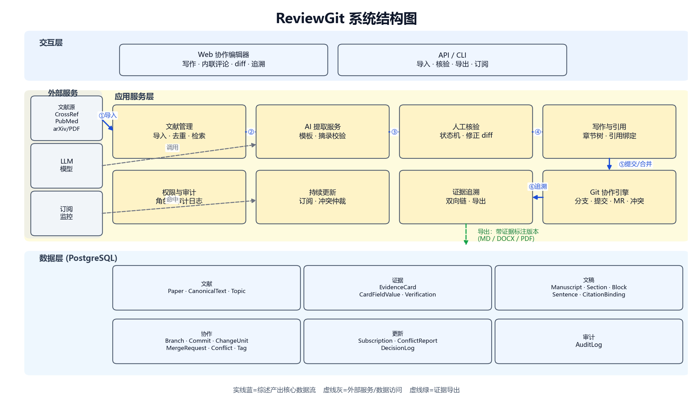

# Σcholar Lineage Studio（溯文）· 证据可追溯的协作综述工作台

[](https://github.com/YueQiandesedianzi/-cholar-Lineage-Studio/actions/workflows/pylint.yml)
[](LICENSE)
[](https://www.python.org/)

把「文献建库 → 统一提取 → 人工核验 → 章节组织 → 分支审核与合并 → 标签快照」放进**同一个可移植的本地项目**：每条实质性论断都能回溯到来源文献的逐字摘录，每次修改都有可复核的分支、提交与审核记录。

它按通用 AI 技能目录组织（`SKILL.md` + `references/` + `assets/`），可复制给支持该目录结构的 AI 助手使用；也自带一个零构建的 Flask + SQLite Web 界面，可直接在本机跑起来。

> **Σcholar Lineage Studio（溯文）** 是对外品牌；技术包名与协作 API 保持 `ReviewGit` 兼容。
> 本目录是**规范版插件与继续开发目录**，不回写早期原型。它不是 DSH 原生 bundle，**不依赖 Git 二进制**。

```bash
python -m pip install -r web/requirements.txt
python scripts/launch.py          # 首次自动灌入演示语料并启动
# → http://127.0.0.1:5000
```

没有数据库时会自动灌入聚酰亚胺建模演示语料：**21 篇文献 / 84 张证据卡片 / 8 节框架**。

---

## 目录

- [它解决什么问题](#它解决什么问题)
- [系统结构](#系统结构)
- [快速开始](#快速开始)
- [界面工作流](#界面工作流)
- [特性](#特性)
- [核心概念：ChangeUnit](#核心概念changeunit)
- [REST API](#rest-api)
- [合并与版本规则](#合并与版本规则)
- [当前状态一览](#当前状态一览)
- [当前边界（重要）](#当前边界重要)
- [测试与持续集成](#测试与持续集成)
- [目录结构](#目录结构)
- [打包与分发](#打包与分发)
- [常见问题](#常见问题)
- [致谢与许可](#致谢与许可)

---

## 它解决什么问题

多人合写综述时，最常见的三个坑：

| 坑 | 本项目的做法 |
|---|---|
| AI 摘出来的"证据"其实是概括，甚至凭空生成 | 摘录必须是来源文本的**逐字子串**，机器先校验再允许人工核验通过 |
| 合并靠整篇文档覆盖，改了什么、谁改的说不清 | 变更以**结构化单元**（卡片字段 / 章节节点 / 段落）为单位提交，逐单元比对 |
| 分工写作时互相覆盖、审核流于形式 | **分支隔离 + 合并请求 + 非作者批准**，历史追加不可改写 |

一句话：**证据链与版本历史落在同一个可移植项目里，而不是散在聊天记录和文件名里。**

## 系统结构



> 此图是 **AI 生成的示意插画**（Doubao-Seedream 5.5），用于快速建立整体印象；图中文字与数字可能存在生成误差，**以本文档、REST API 表和代码为准**。它对应 2026-11-12 的本地实现：Flask 单进程 + SQLite、Mock 提取器、本地单项目协作内核。虚线区列出的能力属于后续扩展，不是当前可用功能。

## 快速开始

**环境**：Python 3.8+ 与 Flask ≥ 3.0（CI 在 3.10 / 3.11 / 3.12 上做静态检查）。

```bash
# 1. 安装依赖（仅 Flask）
python -m pip install -r web/requirements.txt

# 2. 启动（首次自动灌入演示语料）
python scripts/launch.py

# 其他常用参数
python scripts/launch.py --seed          # 删除并重建演示语料后启动
python scripts/launch.py --port 8000     # 换端口
python scripts/launch.py --host 0.0.0.0  # 换监听地址（默认 127.0.0.1）
```

浏览器打开 `http://127.0.0.1:5000`。

| 环境变量 | 作用 | 默认 |
|---|---|---|
| `REVIEWGIT_DB` | 指定 SQLite 文件路径 | `web/reviewgit.db` |

> ⚠️ `--seed` 会**删除并重建**目标数据库（包括你手工建立的卡片与协作历史）。请在测试副本上使用；分发包默认不含数据库。

## 界面工作流

界面共五个标签页：**文献 / 提取模板 / 提取与核验 / 综述框架 / 协作与版本**。

1. 在「文献 / 提取模板 / 提取与核验 / 综述框架」准备文献、卡片和章节。
   「提取与核验」页提供状态统计徽章（点击即筛选）、搜索与多维度筛选、批量通过/驳回、字级修订 diff，以及键盘流：`j`/`k` 移动、`a` 通过、`r` 驳回、`e` 修订、`Enter` 保存、空格勾选。
2. 在「协作与版本」按**五步向导**走：选择/新建分支 → 提交修改 → 发起合并请求 → 审核 → 解决冲突并合并。向导会标出当前步、阻塞原因和"下一步"。
   提交时用三级可读选择器（对象类型 → 对象 → 新内容），无需手写 `unit_key`；`unit_key` 只读展示、可一键复制到评论。
   合并请求页提供时间线（提交 / 审核 / 评论 / 冲突解决）与"还需几位批准"，并可查看**当前分支相对基线的单元差异**。
3. 以该分支为源、`main` 为目标发起合并请求。
4. 重新检测冲突；审核人必须**不同于 MR 作者**，可提交锚定到 `unit_key` 的内联评论，再「批准」或「要求修改」。
5. 有冲突时对比 base / ours / theirs，选择「保留目标 / 保留来源 / 手工内容」；所有活动冲突必须解决。
6. 合并到 `main` 后卡片列表才反映源分支的变更；标签可固定任意主干提交的快照。
7. 在主干提交历史中「回滚此提交」；若该单元后来又被修改，回滚会返回冲突错误而不会静默覆盖。

## 特性

**证据链**

- **题录导入**：粘贴 BibTeX / RIS，或一行一个 DOI（Crossref 联网补全，失败会列出待手工补全项）；按 DOI 或标题自动去重。也支持单篇手工录入标题与摘要。
- **批量提取**：多选文献 + 一个模板顺序提取，带进度与逐条失败汇总。
- **文献与模板建库**：按标题、作者、年份、DOI、摘要建立文献；自定义字段模板并选择生效口径。当前以摘要作为演示全文，**不冒充 PDF 全文解析**。
- **证据卡片与章节组织**：区分论断与逐字摘录，记录来源、状态与自定义字段；支持通过、驳回、修订，以及把已核验卡片挂到章节。
- **原文摘录硬闸门**：人工通过与修订核验会检查摘录是否为原文子串；向 `main` 合并时**再次**检查所有已核验卡片——未通过原文校验的摘录不能被标为已核验。

**协作内核**

- **ChangeUnit 原子变更**：卡片字段、模板字段、章节节点、段落均使用稳定 `unit_key`，以规范化 JSON 的 SHA-256 标识内容，而不是整篇覆盖。
- **真正的分支隔离**：记录分支负责人、用途、起点与当前 head；非 `main` 提交只改自身完整快照，不提前改动主干的活动卡片、章节或段落。
- **三方合并**：沿提交 DAG 找共同祖先，处理无关修改、相同修改、增加与删除；仅当双方以**不同结果**修改同一单元时才报告冲突。
- **MR 审核与内联评论**：默认至少一位非 MR 作者的审核人批准，可配置更高门槛；评论必须锚定本次源分支实际修改的 `unit_key`。
- **有时效的审核**：历史审核保留，但源分支的新提交使旧批准不再计入新 head；`request_changes`、过期预览与未解决冲突均阻断合并。
- **三选一冲突解决**：展示 base / ours / theirs，支持保留目标、保留来源与手工内容；解决人、时间与内容哈希均留痕，重复预览不会无故清除解决记录。
- **标签与非破坏性回滚**：标签保存固定提交的完整快照，不随后续提交改变；回滚生成反向提交，同单元已被后续修改时拒绝静默覆盖。
- **追加式审计与双父提交**：分支、提交、审核评论、冲突解决、合并、标签和回滚均记录操作者与对象；合并提交保留两个 parent。**核验状态改动与章节挂载同样写入审计**，可回答"这张卡片什么时候被谁改过结论"。
- **协作流程向导**：五步状态机（分支 → 提交 → 审核 → 合并）标注当前步与阻塞原因；冲突面板给出三栏解释与三种处理方式的结果预览，非技术作者也能安全处理。

**工程**

- **导出交付**：Markdown 证据稿（章节树 + 已核验卡片 + 参考文献 + 未采用卡片清单）、CSV 证据表、结构化 JSON。**导出前自动校验**：已核验卡片的摘录必须是来源原文子串，不通过会阻止导出并列出问题卡片（可强制导出，稿首标注风险）。
- **稳健与可诊断**：加载 / 空 / 错误三态统一，错误就地给出「重试」；`GET /api/health` 自检结构版本、实体计数与硬性检查；`GET /api/backup/db` 一键备份、`POST /api/backup/restore` 校验后恢复（都会写审计）。
- **移动端与无障碍**：375px 宽度可用（长选项下拉不再撑破布局）；导航 `tablist` 语义、通知 `aria-live`、对话框焦点环、可见焦点样式、表单控件均有可访问名称。
- **自包含、可移植**：运行时路径由 `__file__` 推导，可用 `REVIEWGIT_DB` 指向任意数据库；分发包不含数据库或缓存。
- **零构建前端**：原生 HTML / CSS / JS 单页，无 npm、无构建步骤、无外部 CDN。

> 为什么不用 Git 二进制？综述的编辑对象是**结构化卡片与文稿块**，不是普通文件。字符级 diff 无法回答"这个数字被谁改成多少"，因此协作层自建 `ChangeUnit` + 三方合并，以单元为单位判定冲突。

## 核心概念：ChangeUnit

哈希为规范化 JSON（键排序、UTF-8、无多余空白）的 SHA-256。每个提交保存完整快照；标签保存所指向的快照，不依赖重新猜测内容。

| 类型 | `unit_key` 示例 | 哈希内容 |
|---|---|---|
| `card_attr` | `card_attr:12:claim` | 一个卡片核心字段值 |
| `card_field` | `card_field:12:主要发现` | 一个模板字段值 |
| `block` | `block:5` | 段落的 `section_id/ord/text` |
| `sentence` | `sentence:9` | 预留的句子单元内容 |
| `citation` | `citation:9` | 预留的引用绑定内容 |
| `structure` | `structure:3` | 章节的 `title/parent_id/ord` |
| `metadata` | `metadata:topic:7` | 其他元数据 JSON |

提交示例：

```http
POST /api/branches/2/commits
Content-Type: application/json

{
  "author": "张三",
  "message": "修订卡片 12 的论断",
  "changes": [{
    "unit_type": "card_attr",
    "unit_key": "card_attr:12:claim",
    "old_content": "修改前的论断",
    "new_content": "修改后的论断"
  }]
}
```

`new_content: null` 表示删除单元，且必须显式给出 `new_content`。若携带 `old_hash` 或 `old_content`，服务端会核对分支当前版本，避免覆盖过期编辑。重复键、空提交、空说明与无变化提交都会被拒绝。

## REST API

### 内容与核验（兼容入口，直接作用于主干活动投影）

| 方法 | 路径 | 用途 |
|---|---|---|
| GET / POST | `/api/papers` | 文献列表 / 新增文献 |
| GET / POST | `/api/templates` | 提取模板列表 / 新增模板 |
| POST | `/api/templates/<id>/activate` | 切换生效模板 |
| POST | `/api/extract` | 按模板对文献做 Mock 规则抽取 |
| POST | `/api/papers/import` | 导入 BibTeX / RIS / DOI 列表（按 DOI 或标题去重） |
| GET | `/api/export/markdown` | 导出 Markdown 证据稿（导出前校验摘录；`force=1` 可强制） |
| GET | `/api/export/cards.csv` | 导出证据表 CSV |
| GET | `/api/export/cards.json` | 导出结构化 JSON（文献 + 卡片 + 章节） |
| GET | `/api/cards` | 证据卡片列表 |
| POST | `/api/cards/<id>/verify` | 通过 / 驳回 / 修订 / 退回待核验（通过类动作含摘录子串校验） |
| GET / POST | `/api/sections` | 章节树读取 / 新增 |
| PUT / DELETE | `/api/sections/<id>` | 章节重命名 / 删除 |
| POST | `/api/sections/suggest` | 生成初始章节建议 |
| POST | `/api/cards/<id>/assign` | 把卡片挂到章节 |
| GET | `/api/sections/<id>/cards` | 某章节下的卡片 |

### 协作与版本（18 个路由）

<details>
<summary><strong>展开协作 API 一览</strong></summary>

| 方法 | 路径 | 用途 |
|---|---|---|
| GET / POST | `/api/branches` | 分支列表 / 从 `main` 当前版本创建分支 |
| GET | `/api/branches/<id>` | 分支详情及当前完整单元快照 |
| GET | `/api/branches/<id>/diff` | 当前分支相对基线（默认 `main`）的单元级差异 |
| GET / POST | `/api/branches/<id>/commits` | 分支历史 / 原子提交 |
| GET | `/api/commits/<id>` | 提交、双亲（合并提交）与内容差异 |
| POST | `/api/commits/<id>/revert` | 在 `main` 生成反向提交 |
| GET / POST | `/api/merge-requests` | MR 列表 / 创建 MR |
| GET | `/api/merge-requests/<id>` | MR、审核评论、活动冲突与预览 |
| GET / POST | `/api/merge-requests/<id>/preview` | 以当前两侧 head 重新检测并保留冲突历史 |
| POST | `/api/merge-requests/<id>/reviews` | 批准、要求修改与内联评论 |
| POST | `/api/merge-requests/conflicts/<id>/resolve` | 解决活动冲突 |
| POST | `/api/merge-requests/<id>/merge` | 校验策略并生成合并提交 |
| GET / POST | `/api/tags` | 标签列表 / 固定主干快照 |
| GET | `/api/tags/<id>` | 标签对应的完整快照 |
| GET | `/api/audit-logs` | 追加式审计记录（支持 `entity_type` / `entity_id` / `limit` 过滤） |
| GET | `/api/health` | 自检：结构版本、实体计数、可写性与摘录校验 |
| GET | `/api/backup/db` | 下载数据库一致性快照（SQLite 文件） |
| POST | `/api/backup/restore` | 用上传的 SQLite 文件恢复（校验文件头与必要表，写审计） |

常用审核请求：

```json
{"reviewer": "李老师", "verdict": "approve",
 "comments": [{"unit_key": "card_attr:12:claim", "body": "请核对措辞"}]}
```

`verdict` 只能是 `approve / request_changes`。

冲突解决 `resolution` 的语义：

- `keep_base`：**保留目标分支当前内容（ours）**——兼容数据模型里的枚举名，**不是**回退到共同祖先；
- `keep_branch`：保留来源分支当前内容（theirs）；
- `manual`：显式传入 `manual_content`，可以是 JSON，也可以是 `null`（表示删除）。

</details>

## 合并与版本规则

- 通过提交 DAG 找当前源 / 目标 head 的共同祖先，而不是始终使用分支起点。
- ours 与 theirs 相同：直接采用；只有一侧相对 base 改变：采用改变侧；双方改成不同内容：冲突。
- MR 默认需要 1 位非作者审核人的**当前轮**批准；源分支新增提交后历史批准仍保留，但不计入新 head。
- `request_changes`、过期预览、未解决冲突都会阻断合并，不会产生"半截提交"。
- 合并提交记录两个 parent；审计记录操作者与对象；历史接口不提供删除或重写。
- Tag 只能指向 `main` 直接拥有的提交，重名会被拒绝；Revert 是带 `reverts_commit_id` 的新提交。
- `main` 的 `cards / sections / blocks` 是活动投影；非 `main` 提交不会提前修改这些表。

## 当前状态一览

| 能力 | 状态 |
|---|---|
| 文献 / 模板 / 提取 / 核验 / 章节 / 卡片挂载 | ✅ 已实现（提取为 Mock 规则） |
| 逐字摘录硬闸门（提取时与合并时双重校验） | ✅ 已实现 |
| ChangeUnit 分支 / 提交 / MR / 审核评论 | ✅ 已实现（本地单项目） |
| 三方合并 / 三选一冲突解决 / 标签 / 回滚 / 审计 | ✅ 已实现 |
| 真实 LLM Provider（替换 `mock_extract()`） | ⏳ 未实现 |
| PDF 解析与 CanonicalText 全文入库 | ⏳ 未实现 |
| 句级引用绑定与孤儿论断检测 | ⏳ 未实现（`sentence` / `citation` 可版本化存储，但无编辑器） |
| 用户、成员角色与服务端鉴权 | ⏳ 未实现 |
| PostgreSQL / 多项目 / 多进程任务队列 | ⏳ 未实现（SQLite 适合当前本地单进程场景） |
| 订阅监控 / 冲突仲裁 / 撤稿标记 / 历史版本导出 | ⏳ 未实现 |

## 当前边界（重要）

- 这是**本地、单项目、无认证**的协作内核。作者、审核人与操作人只是审计文本，**不代表安全身份验证**；尚未实现 PRD 中的用户与服务端授权，**不应直接暴露到不受信任的网络**。
- 首次打开协作接口时，会以现有卡片和章节创建根提交。原有导入、提取、核验与框架接口是兼容入口，**直接作用于活动投影、不会自动生成提交**；建议先完成这些准备，后续版本化编辑再走 ChangeUnit 提交。
- 删除活动投影里的行不会破坏历史：不可变提交与标签仍可恢复内容。
- `merge_policy` 的完整项目设置页尚未实现；当前 MR 默认最少 1 个批准，可创建时指定更高门槛。
- **Token 赞助与模型接入是两件事**：本项目获得 Token 赞助，但当前仍是 Mock 规则抽取，未接入真实 LLM。

## 测试与持续集成

```bash
# 20 项测试：19 项 Flask + SQLite 隔离回归，1 项真实进程 / HTTP 冒烟
python -m unittest discover -s web/tests -v
```

覆盖范围：分支隔离、无关 / 相同修改合并、三种冲突解决、审核门槛与失效、内联评论、章节与段落投影、删除侧冲突、标签不可变性、回滚保护、摘录硬闸门。

测试使用临时 `REVIEWGIT_DB` 与 Flask `test_client()`，不会改写正式演示数据库；HTTP 冒烟测试会断言正式库 SHA-256 不变。

CI 只做静态检查（GitHub Actions）：

| 工作流 | 内容 |
|---|---|
| Pylint | Python 3.10 / 3.11 / 3.12，`.pylintrc` 只保留 E / W 级问题，风格项交给代码评审 |

> 测试**没有**调用真实 LLM，不等于模型输出质量或账号连通性验收；HTTP 页面可达也不等于完成了人工视觉或浏览器兼容性验收。

## 目录结构

```text
reviewgit/
├── SKILL.md                         # 技能入口：标准工作流与判定规则
├── README.md                        # 本文件
├── LICENSE                          # MIT
├── .pylintrc                        # CI 静态检查配置
├── .github/workflows/pylint.yml     # GitHub Actions
├── references/
│   ├── extraction-template.md       # 统一提取模板
│   ├── evidence-card-spec.md        # 证据卡片与逐字摘录规范
│   ├── git-workflow.md              # 提交 / 审核 / 合并约定
│   └── roles.md                     # 分工角色说明
├── assets/
│   ├── review-outline-template.md
│   ├── evidence-card-template.md
│   ├── division-of-labor-log-template.md
│   └── reviewgit-structure.png      # 架构示意插画（AI 生成）
├── scripts/
│   ├── launch.py                    # 启动服务（支持 --seed / --host / --port）
│   └── package.py                   # 重建分发快照，排除运行时文件
└── web/
    ├── app.py                       # Flask 入口：内容 API、导入 / 导出与核验校验
    ├── collaboration.py             # ChangeUnit / DAG / MR / 冲突 / 标签 / 回滚 / 审计
    ├── importer.py                  # BibTeX / RIS / DOI 题录解析与去重键
    ├── exporter.py                  # Markdown / CSV / JSON 导出与摘录自检
    ├── seed.py                      # 聚酰亚胺建模演示语料
    ├── requirements.txt             # flask>=3.0
    ├── templates/index.html         # 五个标签页的原生 HTML/JS 界面
    ├── tests/
    │   ├── test_collaboration.py     # Flask + SQLite 隔离回归
    │   └── test_http_smoke.py        # 真实进程与 HTTP 流程
    └── reviewgit.db                 # 运行时自动生成，不进版本库与分发包
```

## 打包与分发

`reviewgit-plugin.zip` 与解压副本都只是**快照**，本目录才是后续开发依据。修改代码后重新打包：

```bash
# 默认生成 dist/reviewgit-plugin.zip 与 dist/reviewgit-plugin/
python scripts/package.py

# 也可显式指定分发目录（不会改动旧的历史 MVP）
python scripts/package.py --output-dir path/to/distribution
```

打包脚本排除数据库、缓存与 `dist`，包含后端、前端、协作模块、测试、说明与结构图；运行时路径均从 `__file__` 推导。

## 常见问题

| 现象 | 原因与处理 |
|---|---|
| 启动后页面空白或 500 | 多半是依赖缺失：`python -m pip install -r web/requirements.txt` |
| 想换一个独立的数据库 | 启动前设置 `REVIEWGIT_DB=/path/to/other.db`；启动器与 `seed.py` 会用同一路径 |
| 「协作与版本」里没有分支 | 协作表在**首次访问协作接口时**创建，并以现有卡片与章节引导 `main` 根提交 |
| 提取结果像是"复制了摘要句子" | 这是设计使然：Mock 提取器只从原文取逐字句子，用来验证摘录闸门；真实 LLM 尚未接入 |
| 演示数据被我改乱了 | 用 `python scripts/launch.py --seed` 重建（会清空该数据库）；也可在「协作与版本 → 维护与诊断」里下载/恢复备份 |
| 想确认库结构或数据是否正常 | 「协作与版本 → 维护与诊断 → 运行自检」，或直接访问 `GET /api/health` |
| 窄屏（手机）布局错乱 | 已在 375px 宽度下验证；若自定了 CSS，注意给 flex 子项留 `min-width:0` |
| 只在局域网/容器里访问 | `python scripts/launch.py --host 0.0.0.0`；但注意当前**没有鉴权**，不要暴露到公网 |

## 致谢与许可

- **Token 赞助**：本项目获得**玻尔（Bohrium）**赞助的 Token 支持，谨致谢意。
- **许可**：MIT，见 [LICENSE](LICENSE)。
- **公开仓库**：[YueQiandesedianzi/-cholar-Lineage-Studio](https://github.com/YueQiandesedianzi/-cholar-Lineage-Studio)。
